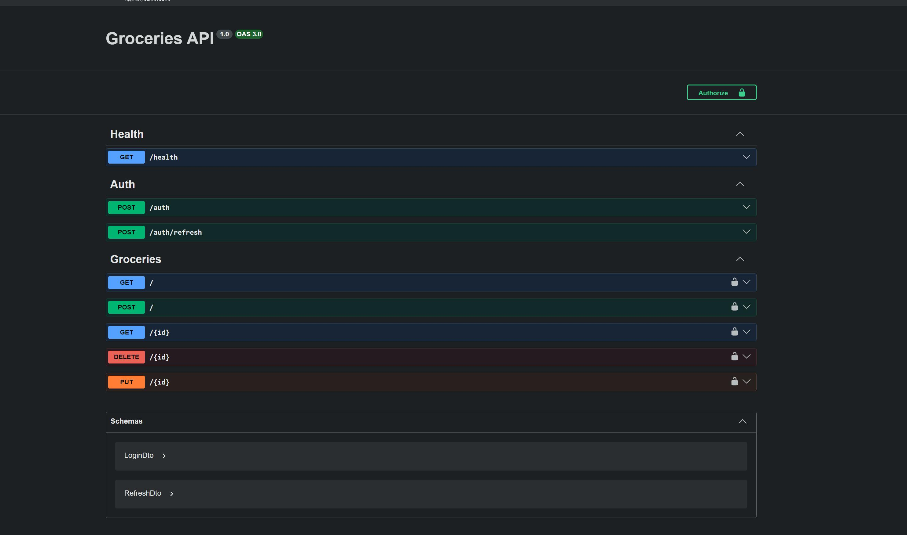

# API contract

What the mobile app expects from the groceries API (Swagger UI at `/docs`).

All routes except `/health`, `/version`, `/auth` and `/auth/refresh` need
`Authorization: Bearer <accessToken>`.

| Tag       | Method | Path            | Body                             | Response                                     |
|-----------|--------|-----------------|----------------------------------|----------------------------------------------|
| Version   | GET    | `/version`      |                                  | `{ latestVersion, minSupportedVersion, releaseNotes[], storeUrls: { android, ios } }` |
| Health    | GET    | `/health`       |                                  | `{ status }`                                 |
| Auth      | POST   | `/auth`         | `{ username, password }`         | `{ accessToken, refreshToken, expiresIn }`   |
| Auth      | POST   | `/auth/refresh` | `{ refreshToken }`               | `{ accessToken, refreshToken, expiresIn }`   |
| Groceries | GET    | `/`             |                                  | `[{ id, name, quantity, category }]`         |
| Groceries | POST   | `/`             | `{ name, quantity, category }`   | the created item                             |
| Groceries | GET    | `/{id}`         |                                  | the item                                     |
| Groceries | PUT    | `/{id}`         | `{ name, quantity, category }`   | the item (created if the id is unknown, which is how Undo restores) |
| Groceries | DELETE | `/{id}`         |                                  | the item, or 404                             |

Access tokens last 15 minutes, refresh tokens 7 days. A 401 means the access
token is missing or expired: the app refreshes once and retries, and signs the
user out if the refresh is rejected.
